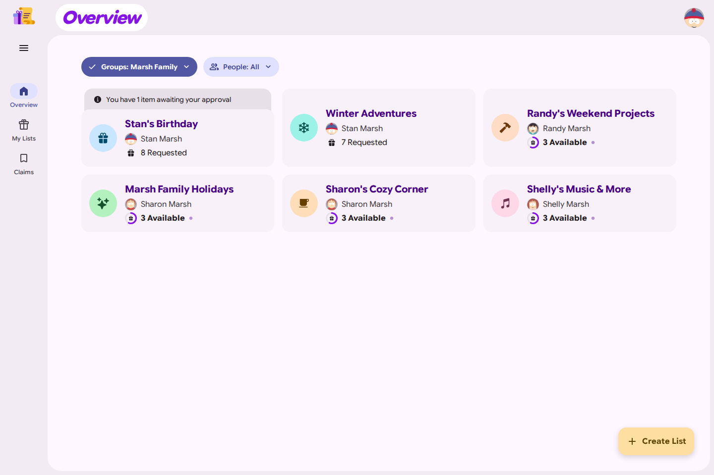
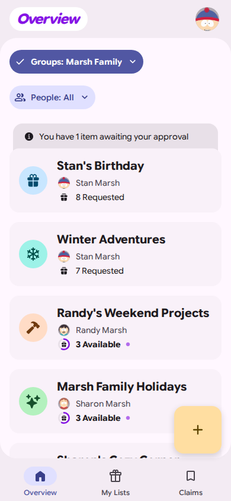
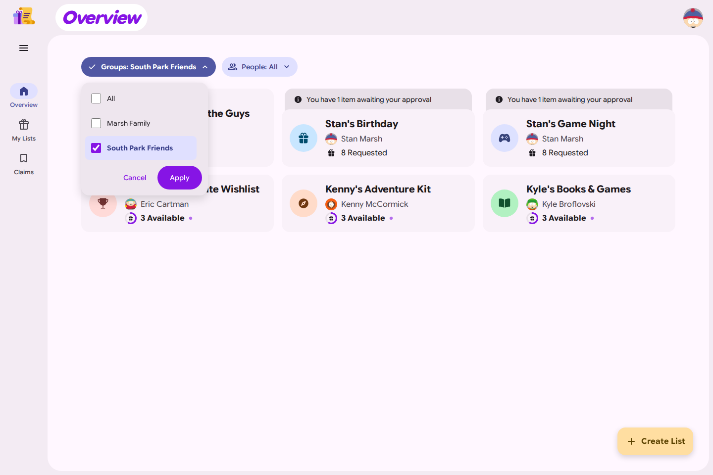
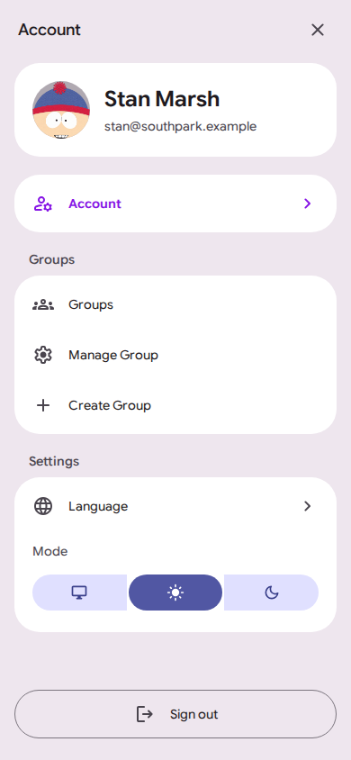
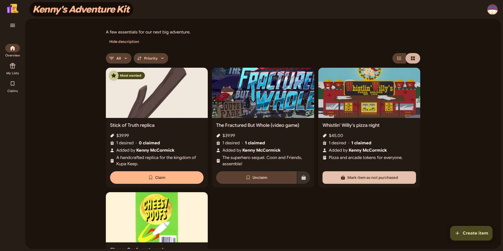
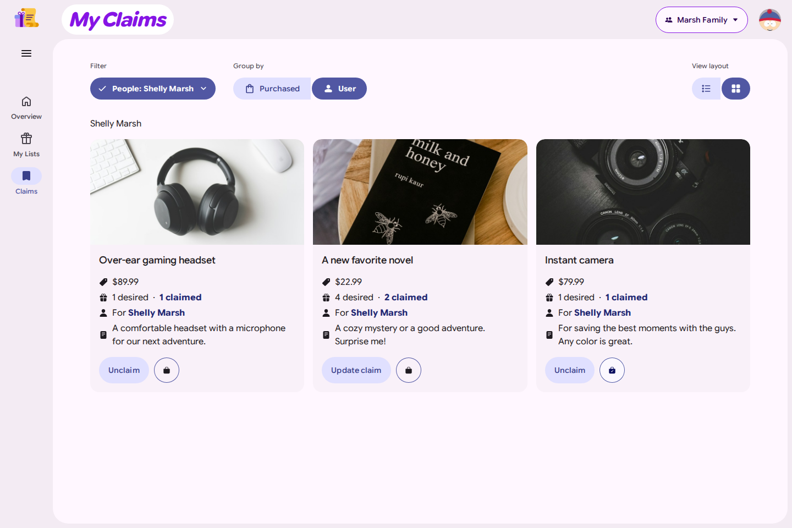
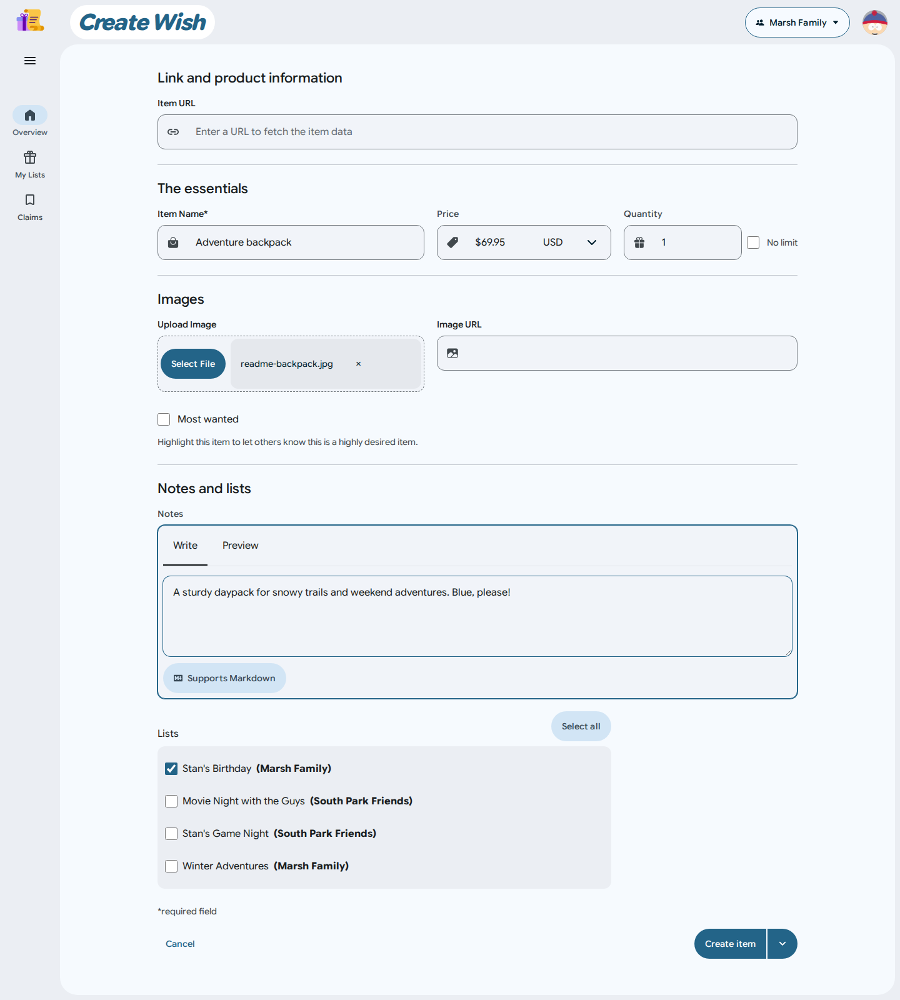

<div align="center">

<h1>Wishlist</h1>
<p> A sharable wishlist for your friends and family </p>
</div>

## About

Wishlist is a self-hosted wishlist application that you can share with your friends and family. You no longer have to wonder what to get your parents for the holidays, simply check their wishlist and claim any available item. With a simple user interface, even the grandparents can get involved!

## Features

- [x] Claim items on a wishlist
- [x] Check off claimed items as purchased
- [x] Automatically fetch product data from URL
- [x] Invite users via email (SMTP configuration required)
- [x] Options for [suggestions](#suggestions)
- [x] PWA Support
- [x] Multiple groups
- [x] Public registries with list managers
- [x] OAuth Authentication

## Screenshots

A look at the Material 3 Expressive interface, with an English UI and fictional
South Park demo data. Stan belongs to both **Marsh Family** (Stan, Randy, Sharon
and Shelly) and **South Park Friends** (Stan, Kyle, Kenny and Eric).

### Friends and family, in their own groups

Colorful lists, gift availability and pending suggestions at a glance. Navigation
adapts from a desktop rail to a bottom bar on mobile.

<p>
    
    
</p>

Filter the overview by group, or share a list with several groups while keeping
reservations in sync.



### Make a wish, plan a gift

Manage your own wishes in a compact text-only list on mobile, approve suggestions,
browse a friend's list, or open your groups, language and theme from the account menu.

<p align="center">
    
    
    
</p>

List colors carry through the interface in light and dark themes. Mark a favorite
as **Most Wanted**, reserve gifts and keep surprises hidden from the recipient.



Keep track of the gifts you have claimed and mark them as purchased.



Create a wish from a product URL, or add the details, image, price and notes yourself.



See [reproducing the screenshots](./docs/readme-screenshots.md) for the isolated
demo database, accounts and capture command. South Park characters belong to their
respective owners and are used here as fictional examples.

## Getting Started

Create a `docker-compose.yaml` file:

```yaml
services:
    wishlist:
        image: ghcr.io/benfayzen/wishlist:latest
        ports:
            - 3280:3280
        volumes:
            - ./uploads:/usr/src/app/uploads
            - ./data:/usr/src/app/data
        environment:
            ORIGIN: http://localhost:3280
        restart: unless-stopped
```

Set `ORIGIN` to the address your users will use to access Wishlist, then start
with `docker compose up -d`. For this example, open `http://localhost:3280`.

To update an existing installation, keep its data and upload volumes and run:

```sh
docker compose pull
docker compose up -d
```

Back up your data and uploads before updating. Application startup may apply
database migrations.

> [!NOTE]
> A [community Helm chart](https://github.com/fox1e-dev/wishlist-charts) is also available.

### Environment Variables

`ORIGIN`: The URL your users will connect to e.g. `https://wishlist.example.com`, `http://localhost:3280`. **Note**, if this value is an IP address, then it must include the exposed port of the application

`TOKEN_TIME`: The amount of time (hours) that signup and password reset tokens are valid for

`DEFAULT_CURRENCY`: The global default currency (ISO-Code) to be used. Currency can still be changed on a per-item basis

`MAX_IMAGE_SIZE`: Maxinum image size that can be uploaded (in bytes). Defaults to 5000000 (5MB)

### Running behind a reverse proxy

It is recommended to run Wishlist behind a reverse proxy. Currently, Wishlist does not support running on a different subpath (i.e. `https://domain.com/wishlist`).

#### Nginx / Synology NAS

There is a [known issue](https://github.com/cmintey/wishlist/issues/170) when running behind Nginx or Synology NAS (which uses Nginx under the hood) proxies. It is recommended to set the following properties in your Nginx configuration:

```Text
proxy_buffer_size   128k;
proxy_buffers   4 256k;
proxy_busy_buffers_size   256k;
```

## Groups

Each list has one owner and can be shared with several groups, such as friends
and family. Shared lists use the same wishes and reservations, helping prevent
duplicate gifts. Change visibility in the list's group selection. My Lists shows
all your own lists; the overview defaults to all your groups and offers a group
filter without changing a global group selection.

Open Account → Groups to see your memberships, create groups, leave groups or
open the groups you manage. Your lists and reservations are kept when you leave.

Currently, anyone can create a group. The group creator is automatically added as a "manager" of the group. A Group Manager can invite users to Wishlist and add/remove existing users to the group they manage. The Group Manager can also delete the group. An Admin will have the same permissions as the Group Manager.

## Registries

When creating a list, choose Wishlist or Registry. A wishlist belongs to its owner
and can be shared with several groups. A registry belongs to no group, is always
public through its link, and has list managers instead of an owner. The creator
becomes its first manager. A registry can also be created without joining a group.

Managers can edit the registry, add items, and add or remove managers by exact
username. At least one manager must remain. Removing a manager removes their
management rights, including those of the original creator. My Lists shows the
wishlists you own and the registries you manage once each. Group filters apply to
wishlists; registries appear when no group filter is selected.

Registries use the installation-wide claim settings. Visitors can view and reserve
registry items without an account. The list type is
fixed after creation. During an upgrade, existing public lists configured as
registries become independent registries, retaining their contents and
reservations. Their former owners become managers. Private lists remain private.

## Configuration

There are several configuration options in the admin panel.

### Public Signup

By default, anyone with the url can signup for an account. You can turn this off and have it be invite only.

If you have [SMTP enabled](#smtp), then you can enter a user's email and an invite link will be sent there. Otherwise, an invite link will be generated for you to copy and send to the user manually.

### Suggestions

Suggestions are enabled by default. With suggestions enabled, you will be able to add items to another person's wishlist. There are a few different suggestion methods.

#### ▶ Approval Required

In this mode, the suggested item will need to be approved by the suggestee in order for it to show up on their wishlist. If the item is approved, it can be edited and deleted by the suggestee at any time.

#### ▶ Auto Approval

In this mode, the suggested item will be automatically approved and added to the wishlist. Similar to the previous method, the item can be edited and delted by the suggestee at any time.

#### ▶ Suprise Me

In this mode, the suggested item is automatically approved and added to the wishlist. **However**, the item only shows for everyone except for the suggestee. The suggestee cannot see and therefore cannot edit or delete the item once it has been added.

### SMTP

SMTP does not need to be configured for the app to function. SMTP enables inviting users via email and the forgot password flow. Without SMTP, you can still manually generate invite links and forgot password links.

### External Authentication

#### OAuth via OpenID Connect

_since v0.42.0_

Wishlist can be configured to authenticate users against any third-party Identity Provider which support the OpenID Connect specification. This includes providers such as Authelia, Authentik, Keycloak, and Google.

To configure your provider for authentication, navigate to the Wishlist Administration Settings page. You will be required to provide the Issuer URL (the URL of your Identity Provider), the Client ID, and the Client Secret. All other configurations are optional. Any and all role-based access should be handled with your Identity Provider.

The redirect URL to specify within your IdP will look like `https://<my_wishlist_domain>/login`

> [!NOTE]
> The first user to be created will need to be created with credentials via the setup wizard.

#### Proxy / Header

> [!WARNING]
> When header authentication is enabled, Wishlist makes no assumptions about the validity of the headers. It is up to you to have your proxy properly configured. An improperly configured proxy **could allow anyone** to gain access to the application by forging the headers.

If you have a reverse proxy you want to use to login your users, you do it via our proxy authentication method. To configure this method, your proxy must send HTTP headers containing the name, username and email for the logged in user.
You configure this using environment variables.

`HEADER_AUTH_ENABLED`: Enable proxy authentication

`HEADER_USERNAME`: The name of the headers that contains the username of the user

`HEADER_NAME`: The name of the headers that contains the full name of the user

`HEADER_EMAIL`: The name of the headers that contains the email of the user

## Add items using a Bookmarklet

Wishlist supports adding items via a bookmarklet. Whenever you're on a product page that you want to add to Wishlist, you can click on your bookmarklet to open Wishlist in a new tab and instantly start creating a new item.

To create a bookmarklet, paste the following code into a [bookmarklet generator site](https://caiorss.github.io/bookmarklet-maker/). Change the two variables that have comments, generate, and save the bookmarklet.

```js
var url = document.URL.endsWith("/") ? document.URL.slice(0, -1) : document.URL;
var wishlist = "http://localhost:5173"; // host of your wishlist instance
var listId = "xyz"; // this is the id of the list you want to add the item to. You can get the id of the list from the URL

var list = "/lists/" + listId;
var dest = new URL(list + "/create-item", wishlist);
dest.searchParams.append("redirectTo", list);
dest.searchParams.append("productUrl", url);
window.open(dest, "_blank");
```

## Contributing

Code contributions are always welcome! If you have something in mind that you would like to work on, please open an issue or comment on an existing issue indicating your interest to make sure someone else isn't already working on it and to discuss any implementation details. Open a PR when you feel that it is ready. You can also open a draft PR as soon as you start work to help track progress.

### Translations

Translations are provided by the community and new translations are greatly appreciated. Translations are managed through [Weblate](https://hosted.weblate.org/projects/wishlist/wishlist-web/). With Weblate, you can contribute an entire language, or make suggestions to existing translations. If the language you wish to translate has not been added yet, you can request it [here](https://hosted.weblate.org/new-lang/wishlist/wishlist-web/). The translation strings use ICU Message Syntax which you can reference [here](https://formatjs.github.io/docs/core-concepts/icu-syntax).

**Translation Progress**


